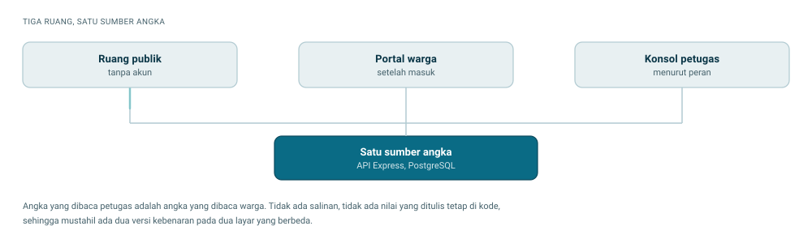

# Jernih — Frontend

Antarmuka platform transparansi layanan air PDAM. Warga memantau pemakaian, saldo, dan pengaduannya secara langsung, sementara data layanan dan kinerja instansi terbuka untuk publik tanpa perlu akun.


<picture>
  <source media="(prefers-color-scheme: dark)" srcset="docs/alur-gelap.svg">
  
</picture>

Dibuat untuk **Web In Action — Multimedia In Action (MIA) 2026**.

Tiga sub-tema yang dipilih, beserta halaman yang mewujudkannya:

| Sub-tema | Halamannya |
| --- | --- |
| **Public Service Tracking** | `/lacak` melacak pengaduan dengan nomor tiket tanpa login, lengkap dengan janji waktu, kronologi penanganan, dan tanda tepat atau terlambat. `/status` memantau kondisi tiap zona lewat peta dan riwayat gangguan. |
| **Open Government Data** | `/statistik` menyajikan neraca air, tolok ukur, dan tren 12 bulan, dengan data mentah yang bisa diunduh sebagai CSV atau JSON berlisensi CC BY 4.0. Alamat API-nya ditampilkan di halaman supaya bisa dipanggil langsung. |
| **Civic Reporting & Accountability** | Alur pengaduan warga dari laporan sampai penugasan teknisi, dan `/kinerja` yang melaporkan ketepatan penanganan termasuk yang terlambat, bukan hanya yang berhasil. |

| | |
| --- | --- |
| Situs produksi | <https://jernih.biz.id> |
| API | <https://api.jernih.biz.id> ([repositori backend](https://github.com/Ahnafprojects/MIA-JERNIH-BE)) |
| Halaman | 34 halaman dalam empat kelompok peran |

Gagasan yang menyatukan seluruh halaman: melacak layanan publik berarti melihatnya sepanjang waktu, bukan satu jepretan. Janji, lalu kenyataan, termasuk ketika kenyataannya meleset.

## Daftar isi

1. [Tech stack](#tech-stack)
2. [Menjalankan proyek](#menjalankan-proyek)
3. [Progres saat ini](#progres-saat-ini)
4. [Peta rute](#peta-rute)
5. [Struktur direktori](#struktur-direktori)
6. [Pengambilan data](#pengambilan-data)
7. [Sistem desain](#sistem-desain)
8. [Jebakan yang pernah memakan waktu](#jebakan-yang-pernah-memakan-waktu)
9. [Penyebaran](#penyebaran)
10. [Yang diukur, bukan dikira](#yang-diukur-bukan-dikira)

Catatan teknis yang lebih dalam, mencakup animasi dan pemecahan masalah, ada
di [`docs/CATATAN-TEKNIS.md`](docs/CATATAN-TEKNIS.md).

Arah visual ringkas ada di [`docs/ARAH-VISUAL.md`](docs/ARAH-VISUAL.md).
Sumber kebenaran nilai warna, huruf, dan utilitasnya tetap
`src/app/globals.css` dan `src/app/layout.tsx`.

## Tech stack

| Lapisan | Pilihan | Catatan |
| --- | --- | --- |
| Framework | Next.js 16.4 | App Router, Turbopack, Partial Prerendering |
| UI | React 19.3 | Server dan client component |
| Bahasa | TypeScript 5 | Mode ketat |
| Styling | Tailwind CSS v4 | Token warna di `src/app/globals.css`, tanpa berkas config |
| Huruf | Bricolage Grotesque, Plus Jakarta Sans, IBM Plex Mono | Dimuat lewat `next/font` |
| Peta | MapLibre GL 6 dan react-map-gl | Basemap vektor CARTO, tanpa API key |
| Grafik | Recharts 3 | Deret waktu dan perbandingan |
| Validasi | Zod 4 | Validasi formulir |
| Ikon | lucide-react | |

Backend terpisah: [MIA-JERNIH-BE](https://github.com/Ahnafprojects/MIA-JERNIH-BE), dibangun dengan Express 5, Prisma 7, dan PostgreSQL.

## Menjalankan proyek

### Prasyarat

- Node.js 22 atau lebih baru
- npm 10 atau lebih baru

### Langkah

```bash
git clone https://github.com/Ahnafprojects/MIA-JERNIH-FE.git
cd MIA-JERNIH-FE
npm install
cp .env.example .env.local
npm run dev
```

Buka <http://localhost:3000>.

### Konfigurasi

Hanya satu variabel yang wajib diisi di `.env.local`:

```ini
NEXT_PUBLIC_API_URL=https://api.jernih.biz.id
```

Backend produksi sudah berjalan, jadi tidak ada yang perlu dinyalakan selain perintah di atas. Untuk menunjuk backend lokal, ganti nilainya menjadi `http://localhost:4000` dan pastikan asal yang dipakai terdaftar di konfigurasi CORS backend. Perlu diperhatikan bahwa `http://localhost:3000` terdaftar sedangkan `http://127.0.0.1:3000` tidak, dan keduanya adalah asal yang berbeda bagi peramban.

Konsekuensi menunjuk backend produksi perlu disadari. Uji coba pembelian
menyentuh basis data sungguhan dan meninggalkan transaksi di sana. Endpoint
backend yang baru dibuat akan membalas 404 dari localhost sampai ia
dideploy, dan gejalanya terbaca seperti kode frontend yang salah padahal
bukan.

### Perintah lain

```bash
npm run build      # build produksi
npm run lint       # ESLint
npm run typecheck  # tsc --noEmit
npm start          # menjalankan hasil build
```

## Progres saat ini

**Seluruh 34 halaman sudah jadi dan terhubung ke backend sungguhan di
produksi.** Tidak ada lagi halaman kerangka. Seluruhnya mengambil data dari
`api.jernih.biz.id`, tanpa data tiruan.

| Bagian | Halaman |
| --- | --- |
| Fondasi | Sistem desain, token tema terang dan gelap, komponen dasar dan domain |
| Layout | Publik, portal, dan konsol, masing-masing dengan navigasi responsifnya |
| Publik (6) | Landing, Fitur, Status Layanan, Lacak Pengaduan, Rapor Kinerja, Statistik |
| Autentikasi (6) | Masuk, Daftar, Verifikasi, Lupa sandi, Atur ulang, Hubungkan meter |
| Portal warga (10) | Beranda, Beli, Token, Bayar, Pemakaian, Riwayat, Meter, Bantuan, Notifikasi, Akun |
| Konsol petugas (12) | Dashboard, Pelanggan, Detail pelanggan, Peta, Perangkat, Token, Insiden, Broadcast, Audit, Laporan, Analitik, Pengaturan |
| Lintas halaman | Penjaga rute berbasis peran, responsif 320 sampai 1920 px, aksesibilitas, tema gelap |

Yang ditambahkan paling akhir, menjawab saran pengembangan pada tahap FDS:

| Kemampuan | Letaknya |
| --- | --- |
| Peragaan kabar WhatsApp dan Telegram | `(publik)/_bagian/kabar-langsung.tsx` |
| Halaman Fitur tersendiri | `(publik)/fitur/page.tsx` |
| Pendaftaran saluran kabar oleh warga | `(portal)/akun/_bagian/saluran-kabar.tsx` |
| Peta sebaran titik kebocoran | `components/peta/titik-kebocoran.tsx` |
| Pemilih lokasi aduan dari GPS | `(portal)/bantuan/_bagian/titik-lokasi.tsx` |

Belum dikerjakan: notifikasi push peramban dan mode luring.

## Peta rute

34 halaman dalam empat kelompok. Satu aplikasi melayani tiga peran, dan
tampilannya menyesuaikan siapa yang masuk. Bukan tiga situs terpisah.

### `(publik)` — tanpa akun

| Rute | Isi |
| --- | --- |
| `/` | Landing: hero video, pita angka jaringan, sorotan fitur, peraga meter, cara kerja, peragaan kabar WhatsApp dan Telegram |
| `/fitur` | Dua belas kemampuan portal sebagai daftar bergaris, masing-masing diverifikasi ke kode yang menegakkannya |
| `/status` | Status tiap zona: peta, sebaran titik kebocoran, keandalan 30 hari, riwayat gangguan |
| `/lacak` | Lacak pengaduan dengan nomor tiket, janji waktu, alur penanganan |
| `/kinerja` | Rapor kinerja SLA: ketepatan, waktu tanggap, rincian per kategori |
| `/statistik` | Neraca air, tolok ukur, tren 12 bulan, unduhan data |

### `(auth)` — pintu masuk

`/masuk`, `/daftar`, `/verifikasi`, `/lupa-sandi`, `/atur-ulang`, `/hubungkan-meter`

Seluruhnya berbagi `AuthShell`: panel merek beranimasi di kiri, formulir di kanan.

Verifikasi dilakukan sepenuhnya lewat email dengan kode enam digit yang
berlaku sepuluh menit. Tidak ada SMS di mana pun.

### `(portal)` — warga

| Rute | Isi |
| --- | --- |
| `/beranda` | Saldo sebagai bola kaca, debit, layar meter, penyegaran tiap lima detik |
| `/beli`, `/bayar/[invoice]` | Paket liter sebagai tabel, nominal bebas, pembayaran |
| `/token` | Isi token lewat halaman atau simulasi keypad meter |
| `/pemakaian` | Grafik kolom air, proyeksi saldo, peta panas tujuh hari kali dua puluh empat jam |
| `/riwayat` | Tabel transaksi, struk yang bisa dibuka ulang dan dicetak |
| `/meter` | Perangkat, layar LCD, deteksi kebocoran dini hari |
| `/bantuan` | Pengaduan dengan pemilih lokasi peta dan unggah foto |
| `/notifikasi`, `/akun` | Notifikasi dalam aplikasi, dan pendaftaran saluran WhatsApp serta Telegram |

### `(konsol)` — petugas PDAM

`/konsol`, `/konsol/pelanggan`, `/konsol/pelanggan/[id]`, `/konsol/peta`,
`/konsol/perangkat`, `/konsol/token`, `/konsol/insiden`,
`/konsol/broadcast`, `/konsol/audit`, `/konsol/laporan`,
`/konsol/analitik`, `/konsol/pengaturan`

Panel tim pada halaman pengaturan hanya terbuka bagi peran supervisor.

## Struktur direktori

```text
src/
├── app/
│   ├── (publik)/          Tanpa login: landing, status, lacak, kinerja, statistik
│   ├── (auth)/            Masuk, daftar, verifikasi, hubungkan meter
│   ├── (portal)/          Warga: beranda, token, beli, pemakaian, meter
│   ├── (konsol)/konsol/   Petugas: dasbor, pelanggan, peta, insiden
│   ├── api/               Rute tiruan, cadangan peragaan luring
│   └── globals.css        Token warna, utilitas, keyframe animasi
├── components/
│   ├── ui/                Komponen dasar lintas halaman
│   ├── domain/            LCD, peraga meter, grafik, kolom air, angka berjalan
│   ├── auth/              AuthShell dan panel air beranimasi
│   ├── peta/              Pembungkus MapLibre dan penanganan kegagalannya
│   └── layout/            Logo, bilah atas, navigasi
├── lib/                   api, use-api, auth-context, penjaga-rute, format, cn
└── types/                 Kontrak data dari backend
```

## Pengambilan data

```text
src/lib/
├── api.ts            Pembungkus fetch, ApiError, refresh otomatis saat 401
├── use-api.ts        Hook pengambilan untuk komponen klien
├── auth-context.tsx  Keadaan sesi
├── penjaga-rute.tsx  Penjaga halaman menurut peran
├── format.ts         Angka, tanggal, satuan. Seluruh pemformatan lewat sini
├── cn.ts             Penggabung kelas
└── hemat-gerak.ts    Pembacaan prefers-reduced-motion
```

Tiga keputusan yang tidak terbaca dari komponen.

**Access token disimpan di memori, bukan `localStorage`.** Refresh token berada di cookie `httpOnly` yang tidak dapat dibaca JavaScript. Token yang tersimpan di `localStorage` bisa diambil skrip pihak ketiga mana pun yang berhasil masuk ke halaman.

**Permintaan memakai `credentials: "include"`.** Cookie refresh ikut terkirim lintas situs. Saat jawaban `401` muncul di luar jalur kredensial, `api.ts` menyegarkan sesi sekali lalu mengulang permintaannya. Tanpa itu, pengguna terlempar ke halaman masuk setiap 15 menit.

**`useApi` tidak punya cadangan data tiruan.** Versi awal proyek ini memilikinya, dan akibatnya halaman tampak baik-baik saja sambil menampilkan angka karangan. Tidak ada yang menyadari servernya mati sampai angkanya dicocokkan dengan basis data. Sekarang, kalau permintaan gagal, `data` tetap `null` dan `galat` berisi pesan dari server, lalu halaman menampilkan keadaan itu apa adanya.

Rute tiruan di `src/app/api/` tidak tersentuh saat aplikasi berjalan normal, karena `NEXT_PUBLIC_API_URL` menunjuk ke backend sungguhan. Keduanya ditahan sebagai cadangan peragaan luring dan sebagai catatan kontrak data.

## Sistem desain

Arah visual lengkap ada di [`docs/ARAH-VISUAL.md`](docs/ARAH-VISUAL.md): palet, pasangan huruf, perangkat struktural, dan daftar tampilan yang dilarang. Baca berkas itu sebelum menulis komponen baru.

Konvensi yang berlaku di seluruh berkas:

- **Seluruh teks antarmuka berbahasa Indonesia.** Pengguna disapa dengan "Anda".
- **Tanpa nilai hex di komponen.** Warna hanya lewat token di `globals.css`.

  Ada dua pengecualian, dan keduanya punya alasan yang sama: warnanya bukan
  milik Jernih, sehingga tidak boleh ikut berganti saat tema berubah.
  Pertama, hijau layar meter pada peraga perangkat. Kedua, hijau WhatsApp
  `#25D366` dan biru Telegram `#2AABEE` pada lambang saluran di seksi kabar
  langsung, sebab keduanya identitas pihak ketiga yang memang tetap di tema
  mana pun.
- **Satuan liter** untuk saldo, token, dan pemakaian. `L/mnt` untuk debit. Agregat jaringan di konsol boleh memakai m³.
- **Angka selalu monospace** dengan kelas `font-mono` dan `tabular`, supaya digitnya tidak bergoyang saat berubah.
- **Warna status selalu didampingi kata.** Sebagian pengguna tidak dapat membedakan warnanya, dan warna kehilangan maknanya saat dicetak hitam putih.
- **Lencana berbentuk persegi dengan garis takar**, bukan kapsul dengan titik bulat.
- **Tema terang dan gelap sama-sama wajib berfungsi.** Bawaannya terang.
- **`prefers-reduced-motion: reduce` wajib mematikan seluruh animasi.**

## Jebakan yang pernah memakan waktu

Lima hal berikut lolos `typecheck`, `lint`, dan `build` tanpa satu pun pesan
galat, tetapi tetap salah. Masing-masing sudah menghabiskan waktu di proyek
ini, jadi dicatat di sini supaya tidak terulang.

**Tailwind v4 memangkas kelas di `@layer utilities` yang tidak punya
selektor telanjang.** Kelasnya terpasang rapi di DOM, tetapi
`document.styleSheets` mengembalikan nol aturan yang cocok. Tidak ada
peringatan Tailwind dan tidak ada galat build. Karena itu `.cincin-fokus`
ditulis dengan satu selektor telanjang walau isinya cuma satu baris.

**Font di dalam `@theme` membuat seluruh situs memakai huruf sistem.**
Ketiga font termuat tetapi tidak pernah dipakai satu kali pun, sebab
nilainya menunjuk variabel yang baru dipasang `next/font` saat jalan,
sedangkan Tailwind membacanya waktu dibangun. Ketiganya sekarang ditulis di
`:root` tanpa `@layer`. Kalau menyentuh bagian ini, periksa
`getComputedStyle(document.body).fontFamily` di peramban.

**`usePathname()` tanpa `<Suspense>` menggagalkan `next build`** dengan
`CLIENT_HOOK_DYNAMIC` pada rute berparameter. Dibuktikan oleh
`/konsol/pelanggan/[id]` yang menggagalkan seluruh build.

**`transition` tidak pernah berjalan pada elemen yang baru dipasang ke
DOM.** Tidak ada keadaan "sebelum" yang sempat tercat, jadi bingkai pertama
sudah menampilkan keadaan akhir. Bahkan dua `requestAnimationFrame`
bertingkat tidak menolong. Elemen baru memakai `@keyframes`; elemen yang
sudah ada dan berubah keadaan memakai `transition`.

**Flag Chrome `--virtual-time-budget` membekukan
`requestAnimationFrame`.** Setiap angka yang dianimasikan terbaca nol dan
halaman tampak kosong padahal datanya ada, sehingga setiap pemeriksaan
animasi lewat flag itu berbohong. Kendalikan peramban lewat CDP. Tab yang
menumpuk juga membekukan rAF, jadi tutup tab sebelum mengukur.

## Penyebaran

Produksi berjalan di Vercel, terhubung ke cabang `main`. Setiap merge memicu build dan rilis otomatis.

Variabel lingkungan yang harus ada di Vercel:

| Nama | Nilai |
| --- | --- |
| `NEXT_PUBLIC_API_URL` | `https://api.jernih.biz.id` |

Variabel berawalan `NEXT_PUBLIC_` disisipkan saat build, bukan dibaca saat jalan. Mengubah nilainya di dasbor Vercel tidak berpengaruh sampai ada build baru.

Dua hal tentang domain yang pernah memakan waktu:

- **Apex dan `www` adalah asal yang berbeda bagi peramban.** Alamat `jernih.biz.id` dialihkan dengan status 308 ke `www.jernih.biz.id`, dan pengalihan itu mengubah header `Origin` yang sampai ke backend. Kalau hanya salah satu yang terdaftar di CORS backend, seluruh halaman tampil sebagai rangka pemuatan tanpa satu pun pesan galat yang menjelaskan sebabnya.
- **Catatan DNS diproksikan Cloudflare.** Untuk subdomain `api.`, proksi itulah yang menutup Cloudflare Tunnel ke server, sehingga jangan diubah menjadi DNS-only.

## Yang diukur, bukan dikira

| Aspek | Hasil |
| --- | --- |
| Kontras teks | 0 gagal dari 1.614 teks, diukur dari piksel pada 5 halaman x 2 tema |
| Responsif | 320–1920 px: 0 gulir mendatar, 0 teks terpotong |
| Sasaran sentuh | 0 di bawah 44x44 px, kecuali atribusi peta yang ukurannya diatur penyedianya |
| Konsistensi data | Legenda peta sama dengan jumlah pin; neraca air sama dengan total kehilangan di tiga rentang |
| Build | 44 entri rute, 12 di antaranya rute tiruan; `tsc` dan `eslint` bersih |

## Tim

**EZ WIN INI MAH** — Web In Action, Multimedia In Action 2026.
